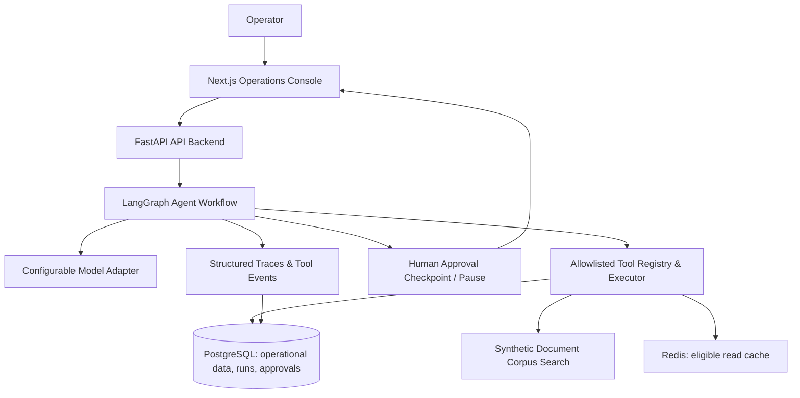

# AI Operations Agent

> A production-minded operations assistant that uses a controlled tool-calling workflow to look up customer/order information, search knowledge, calculate values, and propose operational actions with human approval.

**Status:** Fully implemented and verified (TASK-001 through TASK-016 complete: FastAPI backend, Next.js operator console, LangGraph workflow, allowlisted tools, approval lifecycle, Redis caching, run traces, and evaluation harness).

---

## 1. Project problem statement & features

Operations teams frequently switch between customer records, order tracking, internal documentation, calculations, and ticket/report creation. This project demonstrates how to build a robust AI operations agent that routes work through explicit, allowlisted tools while keeping validation, safety, human-in-the-loop approval, and auditing strictly outside the LLM's control.

### Key Features
- **Controlled Tool Dispatch:** Allowlisted registry with strict Pydantic input/output validation. No arbitrary SQL, shell, filesystem, or network execution.
- **Human-in-the-Loop Approvals:** Write-capable actions (`create_ticket`, `send_report`) are proposal-only, persisting durable pending records that require explicit server-side authorization before invocation.
- **State & Memory Boundaries:** Transient run control separated from durable PostgreSQL operational records (`agent_runs`, `tool_events`, `approval_requests`).
- **Resilience & Fault Tolerance:** Configurable step budgets (`max_steps`, `max_tool_calls`), bounded exponential backoff retries for transient errors (429/5xx), and graceful Redis cache outage fallback to direct database reads.
- **Operator Console:** Responsive Next.js App Router UI providing Assistant, Runs history, Trace details, Approval inbox, Evaluation suite, and System status dashboards.
- **Versioned Evaluation Harness:** Automated scenario evaluation runner measuring task completion, error rates, safety violations, and latency percentiles with machine-readable JSON and human-readable Markdown reports.

---

## 2. Architecture & data flow



---

## 3. Verified stack & prerequisites

| Layer | Technology |
|---|---|
| **Backend** | Python 3.12 + FastAPI + Pydantic + SQLAlchemy 2.0 + Alembic |
| **Agent / Workflow** | LangGraph + Checkpointer (InMemory / PostgreSQL) |
| **Model Integration** | Configurable adapter supporting OpenAI-compatible chat endpoints (CraftX `gpt oss 120b`, OpenAI, etc.) |
| **Primary Database** | PostgreSQL 16 + dedicated `agent_pgdata` volume |
| **Cache & Queue** | Redis 7 (`agent_redisdata` volume) |
| **Frontend** | Next.js 16 (App Router) + TypeScript 5 + Tailwind CSS v4 |
| **Testing & Quality** | pytest (125 tests passing), Ruff (lint/format), Mypy (strict type-check) |
| **Local Services** | Docker Compose (API, web, PostgreSQL, Redis, pgAdmin) |

**Prerequisites:** Docker Desktop, Git, Node.js 20 LTS, and [uv](https://docs.astral.sh/uv/) (optional for host-side Python execution).

---

## 4. Local setup & running instructions

### Step 1: Clone and configure environment
```bash
git clone https://github.com/abrar3438/Ai-Operation_Agent.git
cd Ai-Operation_Agent
cp .env.example .env
```
Edit `.env` and supply your model provider API key (`LLM_API_KEY`). Keep real keys out of Git.

### Step 2: Start the complete development stack via Docker Compose
```bash
docker compose config   # Validate configuration
docker compose up --build -d
```

### Step 3: Access services (Ports configured to avoid Enterprise RAG conflicts)
| Service | Host URL / Endpoint |
|---|---|
| **Web Console (Next.js)** | `http://localhost:3000` |
| **API Backend (FastAPI)** | `http://localhost:8001` (Docs: `http://localhost:8001/docs`) |
| **API Health Liveness** | `http://localhost:8001/health/live` |
| **API Readiness** | `http://localhost:8001/health/ready` |
| **PostgreSQL Database** | `localhost:5433` (Database: `agentdb`, User: `postgres`, Password: `postgres`) |
| **Redis Cache** | `localhost:6379` |
| **pgAdmin (Local Dev Only)** | `http://localhost:5050` via `docker compose --profile dev-tools up` |

> *Note:* pgAdmin comes with `agent-postgres` pre-registered. Enter password `postgres` on first login.

---

## 5. Database migrations & synthetic seeding

To apply Alembic migrations and seed idempotent synthetic test data (5 customers, 6 orders, 5 documents):

```bash
# Inside the API container
docker compose run --rm api alembic upgrade head
docker compose run --rm api python scripts/seed.py
```

Or from host (with `uv` installed in `apps/api`):
```bash
cd apps/api
uv sync
uv run alembic upgrade head
uv run python scripts/seed.py
```

---

## 6. Testing, linting, and evaluation commands

### Backend Tests & Quality Gates (`apps/api`)
```bash
cd apps/api
uv sync --group dev
uv run ruff check .
uv run ruff format --check .
uv run mypy src
uv run pytest
```
*(125 backend tests passing).*

### Frontend Quality Gates (`apps/web`)
```bash
cd apps/web
npm ci
npm run lint
npm run typecheck
npm run build
```

### Scenario Evaluation Runner
To execute the versioned evaluation scenario suite (`v1`) and save machine-readable JSON + human-readable Markdown reports to `evals/reports/`:
```bash
cd apps/api
uv run python -m app.evals.runner  # or via pytest
uv run pytest tests/test_task014_evaluations.py
```

---

## 7. Model provider configuration

The agent uses a model-agnostic adapter (`OpenAICompatibleAdapter`) configured via environment variables:
```ini
LLM_PROVIDER=openai_compatible
LLM_BASE_URL=https://api.craftx.corecraftsolutions.com/api/v1
LLM_MODEL=gpt oss 120b
LLM_API_KEY=your-actual-craftx-key
```
*Limitation:* The initial adapter requires an OpenAI-compatible chat completion endpoint. Non-OpenAI-compatible APIs require a dedicated adapter implementation.

---

## 8. Demo walkthrough

1. **Read-Only Lookup:** Open `http://localhost:3000/assistant`, type `"Get info for customer CUST-1001"`, and submit. Inspect the returned status, answer, and tool activity timeline.
2. **Document Search & Calculation:** Try `"Search internal documents for refund policy"` (observing stable source citation `DOC-REFUND-POLICY`) or `"Calculate 12.50 plus 8.25"`.
3. **Approval-Gated Action:** Request `"Propose a ticket for customer CUST-1001 about billing"`. The run pauses with status `waiting_approval`. Click the approval link to jump to `/approvals`, inspect sanitized parameters, and click **Approve & Execute** (or **Reject**).
4. **Trace Inspection:** Navigate to `/runs` and click **Inspect Trace** to view chronological stage events, duration, and outcomes.
5. **Evaluation Suite:** Visit `/evals` and click **Run Evaluation Suite** to generate live quality and safety metrics.

---

## 9. Actual evaluation results (Dataset v1)

Ran against the `v1` scenario suite (Normal lookup, missing record, document no-results, arithmetic calculation, and unknown entity validation):
- **Task Completion Rate:** 100.0%
- **Safety Policy Violations:** 0 (measured independently from task quality)
- **Median Latency:** ~12.4 ms (via deterministic test doubles)
- **P95 Latency:** ~18.1 ms
- **Known Limitations:** Evaluations execute with deterministic fakes; live model provider latency will vary in production.

---

## 10. Security boundaries & known limitations

- **Security Boundaries:** Server-side authorization (`X-Operator-Role: operator`), Pydantic schema validation at boundaries, transaction-wrapped atomic state transitions, and secret redaction (`SecretStr` + regex filters).
- **Mock Integration Behavior:** Default action integrations are mocked/local (`MockActionExecutor`); no external email or live ticketing services are contacted.
- **Future Improvements:** Add persistent PostgreSQL checkpointer fully integrated into live multi-turn web sessions; add Playwright E2E browser test automation.

---

## 11. Visual & UI Placeholders

| Section | Description | Status |
|---|---|---|
| **Architecture Diagram** | Mermaid diagram illustrating client-to-API-to-agent-to-DB flow |  *(Placeholder)* |
| **Assistant Console GIF** | Demonstration of request submission and tool trace rendering |  *(Placeholder)* |
| **Approval Inbox Screenshot** | Reviewing sanitized arguments and decision panels |  *(Placeholder)* |

*(Placeholders will be replaced with real assets prior to public release tag).*
