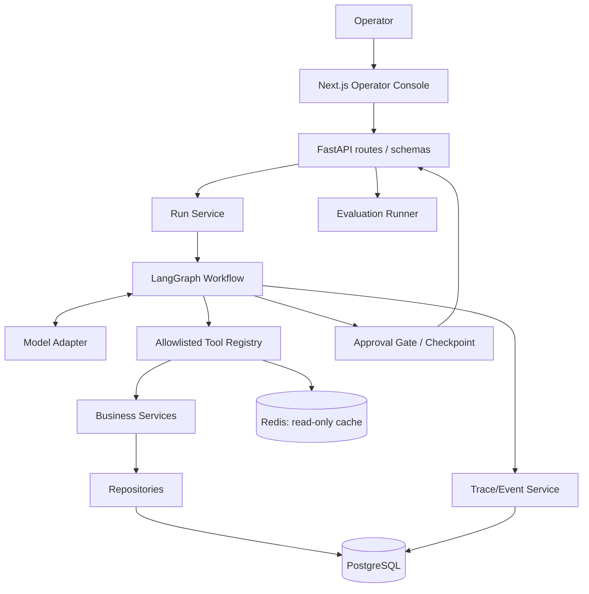
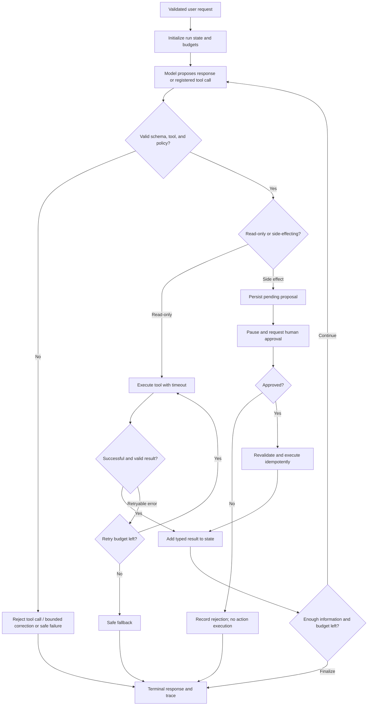

# Architecture — AI Operations Agent

## 1. Architectural principles

- Keep model reasoning, business logic, tool execution, persistence, and UI separate.
- The LLM may propose a registered tool call; trusted application code validates authorization, schema, and policy before execution.
- Treat the model as fallible input, never as the authority for access control, approval, or final action status.
- State-changing actions pause before execution and require an explicit authorized approval.
- Prefer typed data and stable IDs over passing large, formatted text between nodes.
- Make errors, retries, routing, and stopping conditions explicit and testable.
- Use synthetic data and mocked external integrations by default.

## 2. System components

### Web — `apps/web`
Next.js + TypeScript + Tailwind operator console. Calls the FastAPI API; it does not talk directly to PostgreSQL/Redis and does not hold the model API key. UI pages are assistant console, run history/detail, approval inbox, evaluation view, and system status.

### API — `apps/api`
FastAPI owns HTTP validation, request/run lifecycle, approval endpoints, run history, health endpoints, and dependency wiring. Pydantic models define API contracts. The API does not put agent logic directly inside route handlers.

### Agent — `agent/`
LangGraph graph with typed state. Suggested nodes: normalize_request → choose_action/tool → validate_tool_call → execute_read_tool OR create_action_proposal → inspect_result → continue_or_finalize. Approval causes an interrupt/pause with persisted state; after an approval result, the graph resumes and executes the approved action adapter exactly once.

### Model adapter — `models/`
Encapsulates provider connection, request timeouts, output parsing, and model-specific settings. The first adapter targets a documented OpenAI-compatible chat endpoint. Provider-specific code must not leak into graph nodes or business tools. Do not assume all providers or platform keys are compatible solely because they offer an API key.

### Tool registry — `tools/`
Explicit map of registered tool names to typed input schemas and handlers. Tool code calls repositories/services, not raw SQL created by the model. Read-only and side-effecting tools are separately classified. The backend enforces permissions and approval policy regardless of the model's proposal.

### Services and persistence — `services/`, `repositories/`, `db/`
PostgreSQL stores synthetic customers/orders/documents, tickets, report jobs, approval requests, run metadata, sanitized event records, and evaluations. SQLAlchemy models and Alembic migrations are the source of truth for schema changes. Repositories contain database access; services hold business rules. LangGraph checkpoint persistence should use an official supported PostgreSQL checkpointer package/version with its own tested setup/migrations where required.

### Cache — Redis
Redis provides TTL-based cache for approved deterministic read-only lookups. Cache access is optional: an outage must not prevent the underlying repository/service from working. Do not cache side effects, approvals, raw sensitive payloads, or action outcomes in a way that could skip authorization.

### Observability and evaluation — `observability/`, `evals/`
Every run has an ID and ordered event timeline. Events capture stage/tool, timestamps/duration, status, retry count, and sanitized summaries. Evaluation cases and reports are versioned and can run with fake model/tool adapters for reproducibility.

## 3. Architecture diagram

## 4. Agent flow

## 5. State model (conceptual)

Graph state should use typed, minimal fields. Suggested fields:

- `run_id`, `thread_id`, and `request_id`.
- `user_request` (with length limits and appropriate handling).
- `messages` or compact conversation state, as appropriate for the chosen LangGraph pattern.
- `tool_calls_count`, `step_count`, and explicit budgets.
- `tool_results` as structured objects with tool name/status/source IDs, not only prose.
- `pending_approval_id` and approval result only when awaiting/resuming human review.
- `terminal_status`, `final_answer`, and safe error category.

Never store provider keys or secrets in graph state. Do not persist more personal/customer data than required. Define checkpoint retention and deletion behavior before any real sensitive data is introduced.

**TASK-007 state/memory boundaries:** `GraphState` (`apps/api/src/app/agent/state.py`) is transient run control only — bounded request text, compact assistant notes, structured tool observations (name/status/typed result/source IDs), selected-tool metadata, pending control entries, and terminal status. No hidden chain-of-thought, no provider keys, no raw private payloads. Durable truth is PostgreSQL (`agent_runs`, `tool_events`, `approval_requests`, evaluation tables). Budgets are config-driven (`AGENT_MAX_STEPS`, `AGENT_MAX_TOOL_CALLS`, `AGENT_MAX_INPUT_CHARS`, `AGENT_MAX_OUTPUT_CHARS`, `AGENT_MAX_TOOL_RESULTS`, `AGENT_MAX_MESSAGE_CHARS`) and `initial_state`/`compact_state`/`sanitize_result_for_state` enforce them; `state_snapshot_secret_free` rejects secret-bearing state before persistence. The compiled control buffer `pending_tool_calls` is an append reducer (not LastValue) in `langgraph 1.2.14` — verified by inspecting the compiled graph channels, not assumed — so planning/dispatch/routers follow the fresh-entry convention recorded in ADR-014.

## 6. Tool contracts and policy

| Tool | Classification | Contract expectation | Safety rule |
|---|---|---|---|
| `get_customer` | Read-only | ID or approved filters → typed customer summary/not-found | Only approved fields are returned |
| `get_order` | Read-only | ID or approved filters → typed order summary/not-found | Do not disclose unrelated customers' records |
| `search_database` | Read-only | constrained entity/filter query → typed records | No arbitrary SQL, table/column discovery, or mutation |
| `search_documents` | Read-only | query → ranked excerpts with stable source IDs | Source IDs must correspond to retrieved documents |
| `calculate` | Deterministic | allowlisted operation and typed numeric operands → result | No `eval`, code execution, or shell |
| `create_ticket` | Side-effecting | validated ticket draft → pending approval proposal | Must not execute before approval |
| `send_report` | Side-effecting | validated report draft/destination → pending approval proposal | Must not send before approval; mock delivery by default |

## 7. Human approval state transition

Allowed transitions: `pending → approved → executed` or `pending → rejected`. An optional `pending → expired` transition may be introduced if expiry is implemented. No terminal state may transition back to pending. Duplicate approval requests must be idempotent. The approval API must authenticate/authorize the operator and revalidate the proposal immediately before execution. The UI is not the security boundary.

## 8. Data model (initial proposal)

Actual names and normalization may be refined after repository inspection. Changes require migrations and tests.

- `customers`: synthetic customer ID and approved display fields.
- `orders`: synthetic order ID, customer relation, status, timestamps, and allowed summary fields.
- `documents` and optionally `document_chunks`: title/source ID/content or chunk text for knowledge search.
- `tickets`: created ticket records; only after approval.
- `report_jobs`: report request and mocked delivery status; only after approval.
- `approval_requests`: proposed action, typed/sanitized payload, requester/run, status, reviewer, review timestamp, idempotency key.
- `agent_runs`: status, model/provider label (no secret), times, terminal reason, evaluation link where applicable.
- `tool_events`: ordered stage/tool events, duration, status, retry count, redacted metadata.
- `evaluation_runs` and `evaluation_case_results`: dataset version, configuration, metrics, per-case result, failure category.
- LangGraph checkpoint tables: managed by the selected official checkpointer implementation, not hand-rolled unless no supported option exists.

## 9. API surface (proposed)

Use versioning if the API grows; the first local version may remain under `/api/v1` for clarity.

- `POST /api/v1/runs` — submit a request and return run status/result or paused approval state.
- `GET /api/v1/runs` — list runs with bounded pagination/filtering.
- `GET /api/v1/runs/{run_id}` — run summary and final status.
- `GET /api/v1/runs/{run_id}/events` — ordered sanitized trace events.
- `GET /api/v1/approvals` — list pending approvals.
- `POST /api/v1/approvals/{approval_id}/decision` — approve/reject with validated decision payload.
- `GET /api/v1/evaluations/latest` and/or `POST /api/v1/evaluations` — read latest report or run evaluation, protected according to deployment mode.
- `GET /health/live` — process liveness only.
- `GET /health/ready` — readiness of required dependencies, without leaking credentials/config values.

Exact route names must be reconciled with the implementation and reflected in README/OpenAPI. Never expose a public unauthenticated arbitrary-run/evaluation endpoint in a deployed environment without rate limits/access controls.

## 10. Configuration and container topology

Docker Compose should define API, frontend, PostgreSQL, and Redis. pgAdmin is a local development tool and should be localhost-bound or behind a development profile. Database and Redis ports should bind to localhost for local convenience unless a documented deployment topology requires otherwise. Use Compose health checks so API startup respects database readiness. Avoid hardcoded secrets in Compose files; interpolate environment variables and provide safe `.env.example` placeholders.

## 11. Failure and fallback policy

- Invalid tool name/schema: reject; do not dispatch.
- Authorization/approval violation: reject; no retries.
- Record not found: return typed not-found result; do not invent a record.
- Retryable transient dependency error: bounded retry with backoff.
- Timeout/retry exhaustion: safe failure response with trace event.
- Unknown/unsupported request: explain limits or ask a focused clarification; do not force a tool call.
- Malformed model output: attempt only a bounded schema-repair path if implemented; otherwise end safely.
- Cache unavailable: bypass cache and call the underlying read service if healthy.
- Checkpoint/persistence unavailable: fail closed for approval-gated actions; never execute side effects without durable approval state.

## 12. Security boundaries

See `SECURITY.md`. Key rule: tool policy, validation, authorization, idempotency, approval decisions, and final action execution live in trusted backend code. The LLM and frontend may propose/request operations, but neither may enforce its own permission.
